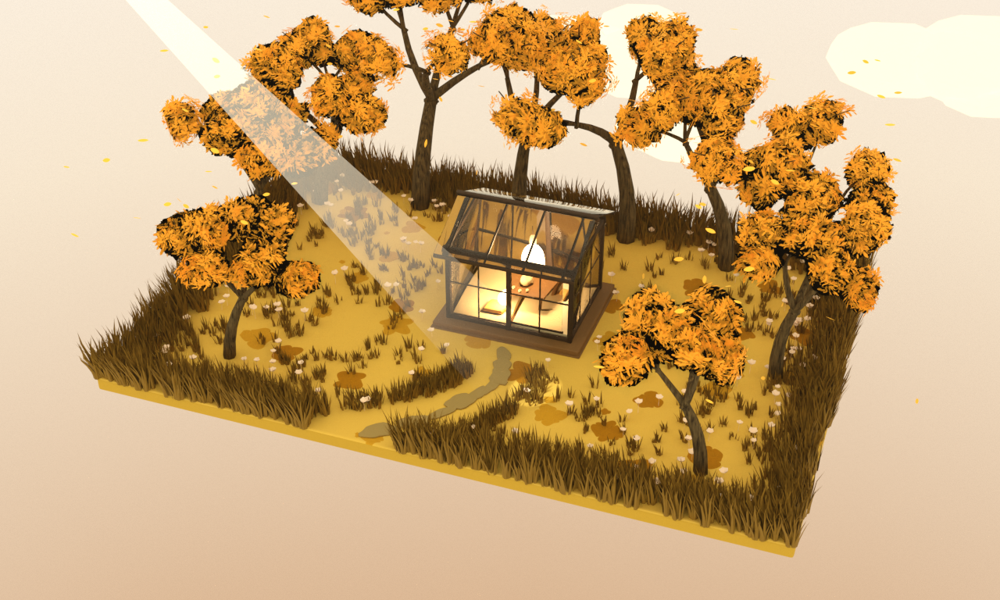
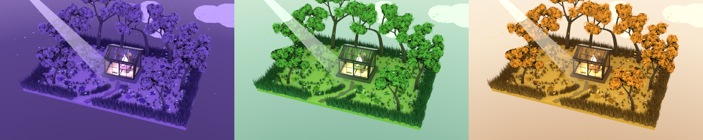

# 紫叶林间小屋 · Procedural Diorama

一个**纯程序化**生成的悬浮微缩地台：16 × 11 米的土层板上，一座四面通透的玻璃茶室、
十棵紫叶树、一片厚涂质感的草地，加一条从门口甩到板缘的石板小径。

零外部模型、零贴图素材——所有几何用 `bmesh` 现算，所有贴图用 `numpy` 现场栅格化，
九张 Python 文件跑完从建模到出图的全流程。



---

## 三套配色，一条命令切换

同一场景、同一机位，只换色板：



**紫叶** `THEME=purple` · **苔绿** `THEME=green` · **麦金** `THEME=gold`（当前默认）

---

## 特点

- **单一纯色**：每个元素只用一种颜色，立体感全部交给光照和形体，不做色彩渐变
- **厚涂是贴图不是几何**：两档色用抖动网格随机且均匀地铺在地面上，侧面看是平的
- **风是真的弯**：几何节点 `Set Position` 只加水平偏移，`(z/h)^1.7` 贴近悬臂梁挠度曲线，
  两个方向的 Z 分量都是 0，**任何顶点都不可能上下移动**（有数值脚本验证 `Δz == 0`）
- **只有两盏灯**：均匀环境光（`Is Camera Ray` 分流）+ 一道 3.8° 聚光灯，
  配一支只对摄像机可见的光柱；室内另加两盏暖光
- **零 `bpy.ops`**：建模全程 `bpy.data` + `bmesh`，清场、合模、倒角都是自己写的函数
- **可复现**：所有随机数用固定种子，同一份代码每次跑出来的场景逐顶点一致

---

## 环境要求

| 项 | 版本 |
|---|---|
| Blender | 5.2 LTS 或更高 |
| Python | 随 Blender 自带（用到 `numpy`）|
| 显卡 | 支持 OptiX 的 NVIDIA 卡（可选，纯 CPU 也能跑）|

不需要安装任何第三方包，不需要下载任何素材。

---

## 快速开始

```bash
cd work/blender

# 默认（麦金）：主视图 + 4 个风相位近景，约 30 秒
"D:\Blender\blender.exe" -b --python build_scene.py

# 半分辨率预览，约 20 秒
QUICK=1 "D:\Blender\blender.exe" -b --python build_scene.py

# 额外渲小屋近景与鸟瞰，全套约 3 分钟
STILLS_ALL=1 "D:\Blender\blender.exe" -b --python build_scene.py

# 96 帧动画（6.5 分钟，验证阶段不需要）
ANIM=1 "D:\Blender\blender.exe" -b --python build_scene.py
```

切换配色：

```bash
THEME=purple "D:\Blender\blender.exe" -b --python build_scene.py
THEME=green  "D:\Blender\blender.exe" -b --python build_scene.py
```

> 脚本里写的是绝对路径，换机器只需改 `build_scene.py` 顶部的 `HERE` 与 `OUT` 两个常量。

验证风场（必须全部 `dz=0.000000`）：

```bash
"D:\Blender\blender.exe" -b --python check_wind.py
```

---

## 产物

| 文件 | 内容 | 参数 |
|---|---|---|
| `renders/01_hero.png` | 主视图 | 1280×768 / 96 采样 |
| `renders/02_cabin.png` | 小屋近景 | 1200×900 / 220 采样 |
| `renders/03_plan.png` | 鸟瞰（看厚涂分布）| 1400×950 / 180 采样 |
| `renders/wind_phases.png` | 四个风相位拼图 | 760×500 / 28 采样 ×4 |
| `work/blender/assets/lilac_cabin.blend` | 完整工程 | Blender 5.2 |

---

## 目录结构

```
.
├── work/blender/
│   ├── build_scene.py        总装：材质 → 地台 → 草 → 花 → 树 → 风 → 小屋 → 灯 → 天空 → 保存 → 出图
│   ├── lib/
│   │   ├── theme.py          三套色板（purple / green / gold）
│   │   ├── lilac.py          色板、材质、bmesh 工具（倒角 / 合模 / 清场）
│   │   ├── ground.py         地台、厚涂、小路、草、花
│   │   ├── tree.py           递归分枝、树叶图集、树皮程序纹理
│   │   ├── cabin.py          玻璃茶室、家具、纸灯
│   │   ├── paintmap.py       厚涂贴图栅格化（numpy）
│   │   ├── sky.py            发光穹顶、云
│   │   ├── shot.py           相机、世界、光柱、渲染设置
│   │   └── anim.py           风（几何节点）、落叶、叶簇摆动
│   ├── check_wind.py         风场数值验证
│   ├── montage.py            四帧拼 2×2 对比图
│   └── assets/               工程文件与三张程序贴图
├── renders/                  出图
├── docs/themes.png           三主题对比图
├── PROJECT_SUMMARY.md        技术栈与审美拆解
└── REPROMPT.md               可复刻提示词（含分阶段提示与验收清单）
```

---

## 已知限制

- 视口切到 Rendered 会很慢：33 万顶点 + 34 m 雾体积 + 半径 260 的发光穹顶，
  6 GB 显存的笔记本第一次还要等 OptiX 编译内核。看效果请直接按 F12 或跑脚本。
- 材质预览（EEVEE）里玻璃不透：需要在材质设置里开「光线追踪透射」才能看到茶室，
  否则玻璃只是一块带高光的板。
- 草的风场是逐顶点形变，没有碰撞，也没有 LOD。

---

## 文档

- [`PROJECT_SUMMARY.md`](PROJECT_SUMMARY.md) — 技术栈、9 条 Blender 5.2 踩坑记录、审美规则与明度阶梯
- [`REPROMPT.md`](REPROMPT.md) — 从零复刻用的提示词：主提示词 + S1–S7 分阶段提示词 + 参数表 + 验收清单

---

## License

代码与生成图像均为本项目原创，可自由使用与修改。
